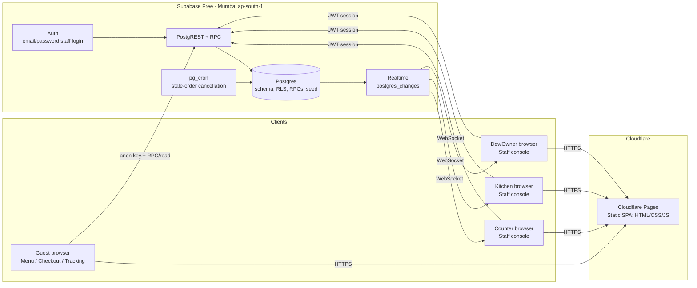

# SADDA DHABA — Owner Guide & System Architecture

This document has two parts:

1. **For the restaurant owner** — what the system does, how to use it day to day, and what to keep safe.
2. **For technical understanding** — what happens behind the scenes, how the system is built, and how data and security work.

**Live links**

| What | Link |
| --- | --- |
| Customer menu (share with guests / QR) | https://sadda-dhaba.pages.dev/ |
| Staff console | https://sadda-dhaba.pages.dev/admin |
| Order tracking | Created per order: `https://sadda-dhaba.pages.dev/order#<token>` (private link shown after checkout) |

---

## Part 1 — Guide for the restaurant owner

### 1. What this system does

SADDA DHABA’s ordering system lets guests place orders from their phone and lets staff manage payment and kitchen work in one place.

- **Guests do not create accounts.** They open the menu, add items, enter name/phone, and place the order.
- **Guests pay at the counter** (cash, UPI, or card machine). There is no online payment gateway.
- **The kitchen only sees paid orders.** An order reaches the kitchen only after counter staff confirms the money was received.
- **Guests can track their order** with a private link/code shown after placing the order.

### 2. How an order moves (simple view)

```text
Guest places order
      ↓
WAITING FOR PAYMENT  (guest sees “Awaiting payment”)
      ↓  counter verifies money and confirms payment
IN KITCHEN QUEUE
      ↓
PREPARING
      ↓
READY (takeaway) or SERVED (dine-in)
      ↓
COMPLETED (handover done)

If not paid in time → CANCELLED automatically
Counter can cancel an unpaid order if needed
Owner/dev can refund a paid order if needed
```

**Important:** “Placed” does not mean “cooking started”. Cooking starts only after payment is confirmed at the counter.

### 3. Staff roles and who can do what

| Role | Who it’s for | What they can do |
| --- | --- | --- |
| **Counter** | Billing/cash counter | See all incoming orders, confirm payment (cash/UPI/card), create walk-in/phone orders, cancel unpaid orders, mark items sold out/available, mark handover completed, view history, reissue a guest’s tracking link |
| **Kitchen** | Kitchen staff | See **paid** orders only, move orders to Preparing → Ready/Served, use fullscreen board and sound alert |
| **Dev / Owner** | Owner/manager | Everything above, plus edit menu and prices, add/remove categories, change GST/settings, issue refunds on paid orders, view full audit trail |

**Owner/dev access:** sign in with the dev account's email and password. Dev-only actions (menu, settings, refunds) are restricted to the dev role and enforced in the database. Keep the password private and let sessions lock when idle.

### 4. Daily operation

#### Counter

1. Sign in at https://sadda-dhaba.pages.dev/admin
2. Open **Counter**.
3. When a guest arrives to pay, find the order by code/name/phone.
4. Verify the money is actually received (cash in hand / UPI received / card approved).
5. Tap **Collect payment**, choose the method, confirm, and submit.
6. The order moves to the kitchen queue immediately.
7. After giving the food to the guest, mark it **Completed**.
8. If a guest placed an order but never paid, you can **Cancel** it (unpaid orders also auto-cancel after the timeout).

#### Kitchen

1. Sign in and open **Kitchen** (tablet/TV works well; use fullscreen).
2. New paid tickets appear with a sound (can be toggled).
3. Start cooking → mark **Preparing**.
4. When ready → mark **Ready** (takeaway) or **Served** (dine-in).
5. Counter marks **Completed** after handover.

#### Owner / Dev

1. **Menu:** add/edit items, change prices, mark sold out, manage categories.
2. **Settings:** restaurant name, GST rate, unpaid-order timeout.
3. **History:** search orders, see audit trail, export CSV for records.
4. **Refunds:** only the owner/dev account can refund a paid order.

### 5. Menu and pricing (current setup)

- **13 categories, 93 items** are preloaded (as provided during setup).
- Prices are stored accurately (in paise) and totals are calculated by the system.
- **GST:** 5% by default (configurable in Settings). Confirm with your accountant whether prices should be treated as inclusive or exclusive for your billing practice.
- If an item is unavailable, mark it **Sold out** — guests will not be able to order it.

### 6. What to keep safe

| Item | Why it matters |
| --- | --- |
| **Owner/dev password** | Full access to menu, settings, refunds, and history |
| **Counter & kitchen passwords** | Control daily operations |
| **Staff credentials file** (provided at setup) | Contains logins and operational secrets — store in a password manager or a locked place, then delete loose copies |
| **Guest tracking links** | Private; anyone with the link can view that order’s status. Counter can reissue a link if a guest loses it |

**If a password or link is exposed:** change/reset the affected password in Supabase, and reissue the guest’s tracking link from the counter if needed.

### 7. Cost, limits, and reliability (zero recurring cost)

| Service | Plan | What to know |
| --- | --- | --- |
| **Cloudflare Pages** (website) | Free | Hosts the app; commercial use allowed; no server to maintain |
| **Supabase** (database, login, live updates) | Free | Stores orders/menu/staff data. **Pauses after ~7 days of inactivity** and has **no automatic backups** on Free |

**Mitigations included in the project**

- A **daily keep-alive** workflow pings Supabase so it stays active (requires GitHub secrets to be added once).
- A **nightly encrypted backup** workflow saves a database dump (requires GitHub secrets/passphrase to be added once). **Test a restore before relying on it.**
- For financial records, export **History → CSV** regularly (e.g. end of day/month).

### 8. First-time checks before a live shift (recommended)

1. Open the guest menu on a phone and confirm items/prices look right.
2. Place a test order and confirm it shows **Awaiting payment**.
3. Confirm the kitchen **cannot** see it until the counter confirms payment.
4. Confirm payment at counter → kitchen sees it → move through Preparing/Ready → Complete.
5. Test a cancellation/refund flow if needed (owner account).
6. Export a history CSV and confirm it opens correctly.

### 9. If something goes wrong

| What you see | What it usually means | What to do |
| --- | --- | --- |
| Kitchen screen is empty | No **paid** orders right now | Check Counter for unpaid orders and confirm payment |
| Order says waiting for payment too long | It may have auto-cancelled after timeout | Check History; place a new order if needed |
| Guest lost tracking link | Link is private and not guessable | Counter: **Reissue customer link** |
| Staff can’t log in / “no staff profile” | Account not linked to a staff role | Owner/admin must check the staff account in Supabase |
| Owner cannot save menu/settings or refund | Account is not an active dev role, or session expired | Sign in with the dev account, confirm its `staff` role is `dev` and active, then retry |
| Site says backend/config issue | Deployment configuration problem | Contact the developer/maintainer |

---

## Part 2 — Behind the scenes & system architecture (technical)

### 1. High-level architecture



**Key idea:** there is **no custom application server**. The browser talks directly to Supabase using the public (anon) key; **Postgres Row Level Security (RLS)** and **database RPC functions** enforce what each user can see and do.

### 2. Technology stack

| Layer | Technology |
| --- | --- |
| Frontend | React 19, TypeScript, Vite 8, Tailwind CSS, TanStack Query, React Router, Supabase JS |
| Hosting | Cloudflare Pages (static build from `dist/`) |
| Database | Supabase Postgres (integer paise for money, constraints, indexes, triggers) |
| Auth | Supabase Auth (email/password staff sessions) |
| API surface | Supabase PostgREST (table reads where allowed) + Postgres RPC (`SECURITY DEFINER` functions) |
| Live updates | Supabase Realtime (`postgres_changes` on orders, order_items, menu_items, categories) |
| Scheduled jobs | `pg_cron` calling `cancel_stale_unpaid_orders()` every 5 minutes |
| Ops automation | GitHub Actions: nightly encrypted `pg_dump`, daily keep-alive ping |

### 3. Data model (core tables)

| Table | Purpose |
| --- | --- |
| `staff` | Links Supabase Auth users to app roles (`dev`, `counter`, `kitchen`) and active status |
| `app_settings` | Single-row settings: restaurant name, `tax_rate_bps` (500 = 5%), `unpaid_timeout_minutes` |
| `categories` | Menu categories (name, sort order, icon) |
| `menu_items` | Items: category, name, description, `price_paise`, veg flag, availability, sort order |
| `orders` | Order header: code (`SD-XXXXX`), customer snapshot (name/phone), type/table, notes, subtotal/tax/total paise, status, payment status/method/reference, timestamps, audit fields |
| `order_items` | Line-item snapshots: item id, name/price/qty/veg at time of order (so history stays correct if menu changes) |
| `order_tokens` | **Only SHA-256 hashes** of guest tracking tokens + timestamps; never the raw token |
| `order_events` | Append-only audit trail: order created, paid, status changes, cancelled, refunded, token reissued, etc., with actor/role/details |

**Money:** stored as integer **paise** (`price_paise`, `subtotal_paise`, `tax_paise`, `total_paise`) to avoid floating-point rounding errors.  
**Tax:** `tax_rate_bps` (basis points), default 500 = 5.00%.

### 4. Roles, RLS, and the payment gate

Access is enforced in the database, not only in the UI:

| Subject | Anonymous guest | Kitchen | Counter | Dev |
| --- | --- | --- | --- | --- |
| Menu/categories/settings read | Yes | Yes | Yes | Yes |
| Orders read | No direct table read (uses token RPC) | **Paid orders only** | Yes | Yes |
| `order_tokens` | No | No | No | No (RLS enabled, no policies; accessed only by security-definer RPCs) |
| `order_events` | No | No | Yes (per policy) | Yes |
| Create/pay/status/cancel via RPC | `quote_order`, `create_order`, `get_order_by_token` | `update_order_status` (allowed transitions) | payment/cancel/walk-in/availability/reissue RPCs | all staff RPCs |
| Refund / privileged config writes | No | No | No | Yes (dev role, enforced by RLS/RPCs) |

**Payment gate:** `mark_paid` is the only operation that moves an order from `AWAITING_PAYMENT` to `QUEUED` (paid). Because kitchen RLS only exposes `payment_status = 'PAID'`, unpaid orders are invisible to kitchen at the data layer.

### 5. Behind-the-scenes flows

#### A. Guest places an order

1. Browser loads the SPA from Cloudflare Pages and fetches menu data from Supabase (public read).
2. **Quote:** client calls `quote_order(items)` RPC → server validates items/quantities against live menu, merges duplicates, computes subtotal/tax/total in paise, and returns authoritative pricing.
3. **Token:** browser generates a high-entropy access token (32 random bytes) and an idempotency key.
4. **Create:** client calls `create_order(...)` with contact snapshot, order type/table, items, notes, token, and idempotency key.
5. Server re-prices from the database (ignores client prices), enforces rate limits, inserts `orders` + `order_items`, stores **`sha256(token)`** in `order_tokens`, records an `ORDER_CREATED` event, and returns the order code/totals.
6. Browser shows the order code and the private tracking URL: `/order#<token>`. The `#token` fragment stays in the browser and is not sent to Cloudflare in normal HTTP requests.

#### B. Guest tracks an order

1. Browser reads the token from the URL fragment and calls `get_order_by_token(token)`.
2. Server hashes the token, looks up the hash, returns order status/totals/items (without exposing internal IDs broadly), and can update `last_viewed_at` (throttled).
3. UI polls/refetches to reflect status changes (and staff views use Realtime invalidation).

#### C. Counter confirms payment (kitchen gate)

1. Counter staff signs in (Supabase Auth, session stored in `sessionStorage`) and sees unpaid orders.
2. After physical verification of money, counter calls `mark_paid(order_id, method, reference)`.
3. Server checks staff role, records payment details/actor/timestamp, sets payment paid and status to `QUEUED`, and writes an audit event.
4. Realtime notifies subscribed clients; the order now satisfies kitchen RLS and appears on the kitchen board.

#### D. Kitchen prepares and completes

1. Kitchen signs in and queries orders; RLS returns only paid orders.
2. Kitchen advances status via `update_order_status` through allowed transitions (`QUEUED → PREPARING → READY/SERVED`).
3. Counter marks final handover as `COMPLETED`. Illegal jumps and unpaid transitions are rejected by the server.

#### E. Cancellation, refund, and stale orders

- **Unpaid cancel:** counter/dev can cancel with a reason (`CANCELLED`).
- **Paid cancel/refund:** dev-only (database-enforced); records refund/cancel reason in audit trail.
- **Auto-cancel:** `pg_cron` runs every 5 minutes to cancel unpaid orders older than `unpaid_timeout_minutes` (default 30).

#### F. Realtime updates

Supabase Realtime publishes changes for `orders`, `order_items`, `menu_items`, and `categories`. The frontend invalidates/refetches React Query data so counter, kitchen, and guest tracking views stay current without manual refresh.

#### G. Staff authentication

- Staff accounts are email/password users in Supabase Auth; each must have an active row in `public.staff` with a role.
- Public signups are disabled; accounts are created by the owner/admin.
- **Dev** privileges are granted by the dev role (no TOTP/authenticator step after login in the current setup). Counter and kitchen also sign in with password only.
- Staff sessions use `sessionStorage` (cleared when the tab closes). Idle lock: counter/dev 15 minutes, kitchen 8 hours. Re-unlocking requires the account password.

### 6. Security model (summary)

- **No customer accounts / no OTP / no online payment data** — reduces sensitive-data exposure.
- **Token secrecy:** raw guest token lives only in the guest’s browser; database stores only SHA-256 hashes; links can be reissued (invalidating the old hash/path of access).
- **Server-side authority:** quoting, pricing, totals, order creation rules, payment gate, and status transitions run in database RPCs with fixed `search_path`.
- **Least privilege:** kitchen cannot see unpaid orders or tokens; anon/authenticated grants are explicit; direct client writes to order/payment tables are not the path.
- **Auditability:** `order_events` records key actions (who/role/what/when/details).
- **Transport & headers:** HTTPS via Cloudflare; `_headers` sets CSP, frame/referrer/content-type protections and restricts connections to the app and `*.supabase.co`.

### 7. Deployment and operations

| Concern | How it works |
| --- | --- |
| Build | `npm run build` → TypeScript check + Vite production build into `dist/` (env vars baked at build time) |
| Hosting | Cloudflare Pages serves `dist/`; `public/_redirects` provides SPA fallback; `public/_headers` applies security/caching |
| Database migrations | `supabase/migrations/0001`–`0005` (schema, RLS/grants, RPCs, seed, Realtime/cron) applied to Supabase project |
| Backups | GitHub Actions `backup.yml`: nightly encrypted `pg_dump` of `public` schema (secrets required). **Restore drills are essential on Supabase Free.** |
| Keep-alive | GitHub Actions `keep-alive.yml`: daily authenticated REST request to prevent free-project pause (secrets required) |
| Observability (lightweight) | Supabase dashboard/logs, Cloudflare deployment status, in-app order history/audit trail, CSV export |

### 8. Known operational notes

- **Supabase Free:** no automatic backups/PITR, shared resources, and projects can pause after inactivity — keep-alive and tested restores matter.
- **GitHub scheduled workflows** may be disabled after long repository inactivity; re-enable or run manually if needed.
- **Auth users vs `public` data:** backups of `public` do not automatically recreate Supabase Auth users; on a full restore to a new project, recreate staff users and re-link `public.staff` rows.
- **Direct deploys:** current live deployment was uploaded from `dist/`; connecting the GitHub repo in Cloudflare Pages enables push-to-deploy (build env vars must be set in Cloudflare).

### 9. Repository map (quick reference)

```text
src/
  components/customer/   guest menu, cart, checkout, token tracking
  components/admin/      login, lock screen, counter, kitchen, menu, history, settings
  components/common/     shared UI (badges, modals, notices)
  context/               cart, staff auth + idle lock, toasts
  hooks/useMenu.ts       data fetching, polling, realtime invalidation
  lib/api.ts             typed Supabase data/RPC layer
  lib/supabase.ts        browser client (sessionStorage auth)
  types/index.ts         shared domain types
supabase/migrations/     schema, RLS, RPCs, menu seed, Realtime + cron
public/_headers          security headers/CSP, caching
public/_redirects        SPA fallback
.github/workflows/       backup and keep-alive automation
BUILD_STATE.md           deployment/build checklist and live status
DOCSHEET.md              this owner + architecture document
README.md                setup, operations, troubleshooting
```

---

*Document prepared for the live SADDA DHABA deployment. For the latest operational checklist, see `BUILD_STATE.md`. For setup and troubleshooting detail, see `README.md`.*
